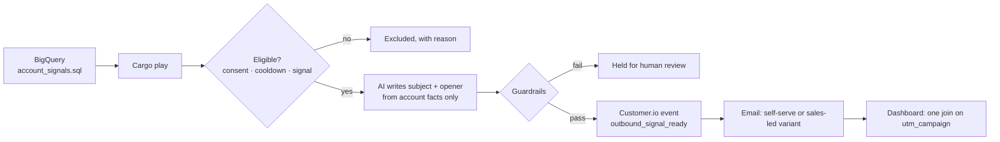

# ai-outbound-engine

**A fully automated outbound play: BigQuery finds the accounts, AI writes the first lines, guardrails check them, Customer.io sends, and every reply is attributed.** It does an SDR team's research and writing, and the sales team takes the calls.

## The story

Booking sales calls used to mean the classic SDR grind: find the right accounts, understand their situation, write a relevant email. That's slow, inconsistent, and impossible to scale with headcount. I rebuilt the motion as a system:

- **BigQuery** selects accounts with a usage signal.
- **Cargo** orchestrates the play.
- **AI** personalizes each email from the account's own data.
- **Customer.io** delivers, with separate variants for self-serve and sales-led accounts.

Account research, writing and sending ran as one system with zero manual prospecting time, and every step, from send to booked conversation, was attributed in the campaign dashboard. Full case study: [sara-beh8.github.io](https://sara-beh8.github.io)

This repo is a **generalized rebuild**: a fictional company (Acme Helpdesk), synthetic accounts, and no employer code or data. The architecture is real and the configurations are examples. Once I understand a company's data, the same pattern lets me rebuild a working AI flow on its own stack quickly: swap the signal query, the proof points and the CTAs.

## How it works



| Step | File | What it does |
|---|---|---|
| Signal | [`sql/account_signals.sql`](sql/account_signals.sql) | BigQuery: high ticket volume + low automation + marketing consent + 30-day cooldown |
| Orchestration | [`config/cargo_play.yaml`](config/cargo_play.yaml) | The Cargo play as a readable spec: source → dedupe → route by motion → AI → guardrails → send |
| Personalization | 🔒 `templates/personalize_prompt.md`, simplified version in [`personalize_prompt.example.md`](templates/personalize_prompt.example.md) | The prompt: only facts from BigQuery, one approved proof point, strict JSON output |
| Guardrails | 🔒 `config/guardrails.json`, simplified version in [`guardrails.example.json`](config/guardrails.example.json) | Product-name dictionary, approved proof points, CTA URLs, UTMs, length limits, banned phrases |
| Delivery | [`templates/email.liquid`](templates/email.liquid) | Customer.io template: AI text from the event, links from config, a fallback on every variable |
| Runner | [`pipeline.py`](pipeline.py) | Runs the whole play locally on a CSV export, offline by default or with Claude via `--live` |

## What's public and what's on request

This repo is a teaser. Everything needed to understand and run the engine is here. The production prompt and the full guardrail set (🔒) are **available on request**: [LinkedIn](https://www.linkedin.com/in/sara-beheyt/). The pipeline runs on the simplified example versions.

## Run it

```bash
python pipeline.py data/accounts_sample.csv --out payloads.jsonl
python -m pytest tests          # 8 tests, no credentials needed
```

```
10 accounts in  ->  5 ready for Customer.io, 0 held for review, 5 excluded
  excluded ACC-1004: no marketing consent
  excluded ACC-1005: contacted recently
  excluded ACC-1006: already automating
  excluded ACC-1007: ticket volume below threshold
  excluded ACC-1010: no contact email
```

The ready events are in [`data/example_payloads.jsonl`](data/example_payloads.jsonl). To use a real model, `pip install -r requirements.txt`, set `ANTHROPIC_API_KEY` and `CLAUDE_MODEL`, and add `--live`.

## Design principles

1. **Clean, legitimate data first.** Consent and cooldown are checked in SQL *and* again in the pipeline. Nobody without marketing consent is ever contacted.
2. **The model writes words, never links.** CTAs and UTMs come from config, so every click is trackable and no AI-invented URL can reach a customer.
3. **Fail closed.** Output that breaks a guardrail is held for a human; it's never sent and never silently fixed.
4. **Measurable from day one.** `utm_campaign` equals the registry slug, so results land in the dashboard with one join. See [`growth-dashboard-spec`](https://github.com/sara-beh8/growth-dashboard-spec) and [`lifecycle-ops-standards`](https://github.com/sara-beh8/lifecycle-ops-standards).
